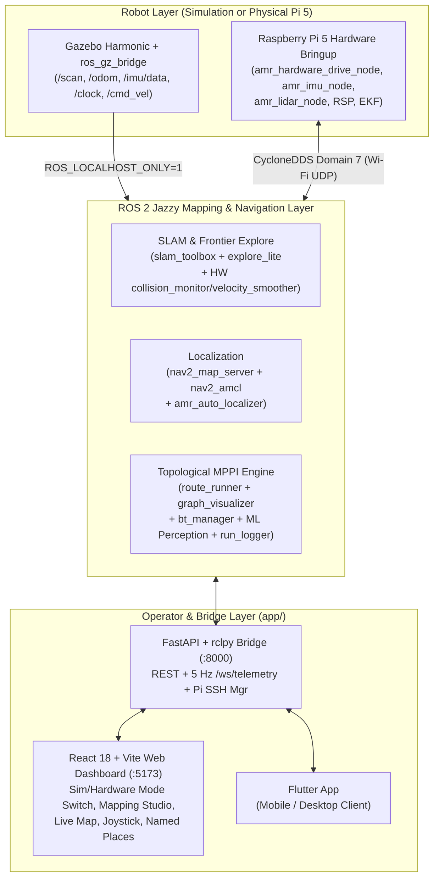

# Autonomous Mobile Robot (AMR) — Warehouse Navigation & Hardware Stack

[](https://releases.ubuntu.com/24.04/)
[](https://docs.ros.org/en/jazzy/)
[](https://gazebosim.org/docs/harmonic/)
[](https://www.python.org/)
[](https://vitejs.dev/)
[](https://fastapi.tiangolo.com/)
[](https://flutter.dev/)

An end-to-end **Autonomous Mobile Robot (AMR)** system supporting both **Gazebo Harmonic simulation** and **physical Raspberry Pi 5 hardware**. The stack combines `slam_toolbox` mapping, `explore_lite` frontier exploration, distance-transform topological roadmap extraction, KD-Tree accelerated Dijkstra routing, 10 Hz vectorized MPPI control with ML-based dynamic obstacle perception, `py_trees` behavior tree recovery, a FastAPI + `rclpy` control bridge, a React + Vite operator dashboard, and a Flutter client.

---

## Robot Summary & Hardware Specifications

Verified from [`src/agv_description/urdf/warehouse_agv.urdf`](src/agv_description/urdf/warehouse_agv.urdf) and [`src/agv_description/launch/hardware_bringup.launch.py`](src/agv_description/launch/hardware_bringup.launch.py):

| Subsystem | Specification | Details |
| :--- | :--- | :--- |
| **Chassis** | Cylindrical differential drive | Diameter `0.22 m` (radius `0.11 m`), height `0.10 m`, base mass `8.0 kg` + casters + wheels |
| **Drive Wheels** | Dual actuated + 2 passive casters | Wheel radius `r = 0.035 m` (`70 mm` diameter), track width `L = 0.240 m`, `4713 ticks/rev` (4× quadrature) |
| **Motor Driver** | RMCS-2305 Dual DC Driver | Hardware closed-loop PI + feedforward on Pi 5 RP1 (`lgpio`, `max_pwm_cap: 35.0%`, `1.5 s` watchdog) |
| **LiDAR** | YDLIDAR X2 (Hardware) / `gpu_lidar` (Sim) | Hardware: `/dev/ttyUSB0` @ `115200` baud (`0.15 m – 8.0 m`, 360 bins, ~10 Hz); Sim: `0.15 m – 12.0 m`, 360 samples, 10 Hz |
| **IMU** | GY-91 MPU-6500 (6-DOF) | I2C Bus 1 (`0x68`), 50 Hz `/imu/data`, startup gyro bias calibration + deadband |
| **State Estimation** | `robot_localization` EKF | 50 Hz fusion of `/odom` + `/imu/data` → `/odometry/filtered` & `odom -> base_link` TF |
| **Compute & DDS** | Pi 5 (`10.244.248.208`) ↔ Laptop (WSL2) | Hardware uses `rmw_cyclonedds_cpp` on `ROS_DOMAIN_ID=7`; Simulation isolates with `ROS_LOCALHOST_ONLY=1` |
| **Operating Speeds** | Mode-calibrated limits | Sim MPPI (`route_runner`): `0.75 m/s` max / `1.80 rad/s`; Hardware Nav: `0.13 m/s` max / `0.40 rad/s`; Hardware Explore: `0.14 m/s` max / `0.45 rad/s` |

---

## Architecture Overview



---

## Repository Directory Map

Matches the current workspace layout (`app/COLCON_IGNORE` excludes `app/` from `colcon build`):

```text
AMR-main/
├── .gitignore
├── README.md                                   # This root hub & architecture overview
├── config/
│   └── cyclonedds.xml                          # CycloneDDS Domain 7 unicast config (Laptop <-> Pi)
├── app/
│   ├── COLCON_IGNORE                           # Excludes app/ from ROS 2 colcon builds
│   ├── README.md                               # Legacy app setup summary (preserved)
│   ├── bridge/
│   │   ├── bridge_server.py                    # FastAPI + rclpy bridge server (:8000) & Pi SSH manager
│   │   ├── requirements.txt                    # Python deps (fastapi, uvicorn, websockets, pydantic, Pillow, numpy)
│   │   └── run_bridge.sh                       # Bridge launcher (sim | hardware [PI_IP])
│   ├── web_dashboard/
│   │   ├── package.json & vite.config.js       # React 18 + Vite (:5173 -> proxies /api & /ws to :8000)
│   │   ├── run_dashboard.sh                    # Native Linux Node launcher for WSL2
│   │   └── src/                                # App.jsx, services/amrBridge.js, components/*
│   ├── flutter_app/                            # Cross-platform Flutter client (lib/, pubspec.yaml, test/)
│   └── docs/                                   # 11 preserved legacy snapshot markdown docs
├── docs/
│   ├── *.md                                    # 25 preserved engineering & milestone markdown docs
│   └── guides/                                 # Modular up-to-date documentation suite (this suite)
│       ├── 01-directory-and-scripts.md         # Folders, map contract, all scripts & ROS 2 nodes
│       ├── 02-simulation-workflow.md           # Build, Gazebo worlds, SLAM, graph extraction & Nav
│       ├── 03-simulation-errors-and-fixes.md   # Verified simulation errors, root causes & fixes
│       ├── 04-hardware-setup-and-pi-workflow.md# Pi 5 setup, CycloneDDS, sync, SSH & bench calibration
│       ├── 05-hardware-mapping-and-navigation.md# Hardware SLAM, explore, safety chain, saving & Nav
│       └── 06-web-dashboard-bridge-and-ml.md   # Bridge API, Web UI, Flutter caveats & ML pipeline
├── maps/                                       # Hardware & user-generated maps (structured layout)
│   ├── json/                                   # *_graph.json, *_places.json, warehouse_graph.json
│   ├── pgm/                                    # Occupancy grid .pgm files (referenced via ../pgm/)
│   ├── png/                                    # Preview floorplans & *_graph_vis.png
│   └── yaml/                                   # Map metadata .yaml (image: ../pgm/<name>.pgm)
├── ml_datasets/                                # Collected/assembled .npz datasets (gitignored)
│   ├── synthetic_lidar_dataset.npz
│   ├── gazebo_live_dataset.npz
│   └── combined_80_20_dataset.npz
├── logs/                                       # Runtime logs, CSVs, Pi pulled logs & latest symlinks (gitignored)
│   ├── hardware_mapping_*.log & hardware_nav_*.log
│   ├── navigation_run_*.csv & navigation_run_*.log
│   ├── ml_pipeline_*/                          # Per-agent ML pipeline logs
│   ├── pi/                                     # Pulled logs from Raspberry Pi via sync_to_pi.sh
│   └── latest_launch.log, latest_run.csv, latest_run.log
├── reports/
│   ├── AMR_Comprehensive_Technical_Report.{tex,pdf}
│   └── AMR_Mathematical_Formulations_Report.{tex,pdf}
├── scripts/
│   ├── hardware/                               # Pi bringup, CycloneDDS env, sync, teleop, mapping, nav, map/graph tools
│   ├── sim/                                    # view_gazebo.sh, view_rviz.sh
│   ├── ml/                                     # run_automated_ml_pipeline.sh
│   └── diagnostics/                            # Bench hardware tests, UDP tester, topic/mapping/system monitors
├── src/
│   ├── agv_description/                        # CMake package: URDF, worlds, models, launch/, config/, maps/, scripts/
│   ├── agv_navigation/                         # Python package: route_runner, bt_manager, auto_localizer, ML & tests
│   └── m-explore-ros2/                         # Forked explore_lite + explore_lite_msgs + map_merge
└── (.venv_ml/, build/, install/, log/)         # Local ML venv & ROS 2 colcon artifacts (gitignored)
```

---

## Quick-Start Matrix

| Workflow | Where to Run | Exact Commands | Guide |
| :--- | :--- | :--- | :--- |
| **1. Build Workspace** | Laptop / Pi | `source /opt/ros/jazzy/setup.bash && colcon build --symlink-install && source install/setup.bash` | [02-simulation-workflow](docs/guides/02-simulation-workflow.md) |
| **2. Sim + Web Dashboard** | Laptop (2 terminals) | **T1:** `./app/bridge/run_bridge.sh` <br>**T2:** `./app/web_dashboard/run_dashboard.sh` → open `http://localhost:5173` | [06-web-dashboard-bridge-and-ml](docs/guides/06-web-dashboard-bridge-and-ml.md) |
| **3. Hardware Pi + Dashboard** | Pi + Laptop | **Pi:** `./scripts/hardware/start_hardware.sh <LAPTOP_IP>` *(or 1-click Auto-Start Pi from UI)* <br>**Laptop T1:** `./app/bridge/run_bridge.sh hardware 10.244.248.208` <br>**Laptop T2:** `./app/web_dashboard/run_dashboard.sh` | [04-hardware-setup-and-pi-workflow](docs/guides/04-hardware-setup-and-pi-workflow.md) |
| **4. Standalone Sim CLI** | Laptop | **Nav:** `ros2 launch agv_description navigation_launch.py` + `ros2 run agv_navigation route_runner` <br>**SLAM:** `ros2 launch agv_description mapping_session.launch.py world:=test1.world run_explore:=true` | [02-simulation-workflow](docs/guides/02-simulation-workflow.md) |
| **5. Standalone Hardware CLI** | Pi + Laptop | **Pi:** `./scripts/hardware/start_hardware.sh <LAPTOP_IP>` <br>**Laptop Mapping:** `./scripts/hardware/start_hardware_mapping.sh 10.244.248.208` <br>**Laptop Nav:** `./scripts/hardware/start_hardware_nav.sh 10.244.248.208 prakash_room` | [05-hardware-mapping-and-navigation](docs/guides/05-hardware-mapping-and-navigation.md) |
| **6. Automated ML Pipeline** | Laptop | `./scripts/ml/run_automated_ml_pipeline.sh` *(add `--headless` for background collection/training)* | [06-web-dashboard-bridge-and-ml](docs/guides/06-web-dashboard-bridge-and-ml.md) |

---

## Modular Documentation Guides (`docs/guides/`)

| Guide | Topics Covered |
| :--- | :--- |
| **[01. Directory Structure & Scripts](docs/guides/01-directory-and-scripts.md)** | Full folder breakdown, `maps/{yaml,pgm,png,json}` contract, `map_paths.py`, `graph_extractor.py`, complete inventory of `scripts/*` and ROS 2 nodes |
| **[02. Simulation Workflow](docs/guides/02-simulation-workflow.md)** | `colcon build`, Gazebo worlds (`test1`, `hospital`, `warehouse`), `mapping_session.launch.py`, map saving, graph extraction, `navigation_launch.py`, `route_runner`, `bt_manager`, dynamic obstacles, `view_gazebo.sh` & `view_rviz.sh` |
| **[03. Simulation Errors & Fixes](docs/guides/03-simulation-errors-and-fixes.md)** | Symptom → Root Cause → Fix playbook: Ogre2/Mesa GPU, WSL2 `npm`, Nav2 Jazzy `bond_timeout` & BT plugins, `map_saver_cli -f`, `explore_lite` `rolling_window` & resilience, DDS leakage, `tf2` shutdown crash, `pytest` CPU contention |
| **[04. Hardware Setup & Pi Workflow](docs/guides/04-hardware-setup-and-pi-workflow.md)** | Pi 5 hardware pinout, CycloneDDS Domain 7 (`config/cyclonedds.xml`, WSL2 `zeth`, Windows UDP 7400–9500 firewall, `ros2 --no-daemon`), `sync_to_pi.sh`, SSH clock sync, 1-click UI vs `start_hardware.sh`, bench calibration tests |
| **[05. Hardware Mapping & Navigation](docs/guides/05-hardware-mapping-and-navigation.md)** | Manual & Auto-Explore hardware SLAM, speed limits & `collision_monitor` safety chain, `save_hardware_map.sh` speckle filtering, `generate_hardware_graph.py`, `start_hardware_nav.sh` + `amr_auto_localizer`, hardware errors & fixes |
| **[06. Web Dashboard, Bridge API & ML](docs/guides/06-web-dashboard-bridge-and-ml.md)** | FastAPI + `rclpy` bridge, mode switching (`sim` ↔ `hardware`), REST & WebSocket API, React Dashboard studio, Flutter `map_screen.dart` caveat, 3-agent ML perception pipeline & 80/20 training |

---

## Preserved Technical Reports & Legacy Documentation

All pre-existing reports and milestone documents are preserved untouched for historical reference and mathematical derivations:

### Formal Reports ([`reports/`](reports/))
- [`reports/AMR_Comprehensive_Technical_Report.pdf`](reports/AMR_Comprehensive_Technical_Report.pdf) ([`.tex`](reports/AMR_Comprehensive_Technical_Report.tex)) — End-to-end engineering architecture, software modules, and hardware validation report.
- [`reports/AMR_Mathematical_Formulations_Report.pdf`](reports/AMR_Mathematical_Formulations_Report.pdf) ([`.tex`](reports/AMR_Mathematical_Formulations_Report.tex)) — Mathematical formulations for kinematics, EKF, distance-transform graph extraction, Dijkstra, and MPPI.

### Preserved Milestone & Architecture Docs ([`docs/`](docs/))
- **Hardware Bringup & Networking:** [`Hardware_Integration_Guide.md`](docs/Hardware_Integration_Guide.md), [`Hardware_Integration_Troubleshooting_Report.md`](docs/Hardware_Integration_Troubleshooting_Report.md), [`laptop_communicatio_gazebo.md`](docs/laptop_communicatio_gazebo.md), [`laptop_com_problems.md`](docs/laptop_com_problems.md)
- **Operational & Troubleshooting History:** [`Running_Guide.md`](docs/Running_Guide.md), [`project_migration_and_troubleshooting.md`](docs/project_migration_and_troubleshooting.md), [`implementation.md`](docs/implementation.md), [`Implementation_Plan_Revised.md`](docs/Implementation_Plan_Revised.md)
- **Mapping, Graph & Navigation Phases:** [`Phase1_Mapping.md`](docs/Phase1_Mapping.md), [`Phase2_Node_Extraction.md`](docs/Phase2_Node_Extraction.md), [`Phase3_Navigation.md`](docs/Phase3_Navigation.md), [`Mapping_Efficiency_Proposal.md`](docs/Mapping_Efficiency_Proposal.md), [`graph_extraction_algorithm.md`](docs/graph_extraction_algorithm.md), [`graph_implementation_plan.md`](docs/graph_implementation_plan.md)
- **Dynamic Obstacles, Milestones & Benchmarks:** [`Dynamic_Obstacle_Guide.md`](docs/Dynamic_Obstacle_Guide.md), [`Dynamic_Obstacle_Avoidance_Improvements.md`](docs/Dynamic_Obstacle_Avoidance_Improvements.md), [`Step1_MultiGoal_Waypoints.md`](docs/Step1_MultiGoal_Waypoints.md), [`Step2_Plan.md`](docs/Step2_Plan.md), [`Step2_Remove_Vision_Code.md`](docs/Step2_Remove_Vision_Code.md), [`step 3_Phase5_Performance_Optimization.md`](docs/step%203_Phase5_Performance_Optimization.md), [`Step4_Behavior_Tree_Orchestration.md`](docs/Step4_Behavior_Tree_Orchestration.md), [`Progress_Report_Topological_Navigation.md`](docs/Progress_Report_Topological_Navigation.md), [`Comparative_Study.md`](docs/Comparative_Study.md), [`Evaluation_Results.md`](docs/Evaluation_Results.md), [`Metric_Comparison_Report.md`](docs/Metric_Comparison_Report.md)

### Preserved Sub-Package & App Snapshots
- **App Legacy Docs (`app/docs/`):** 11 preserved milestone snapshots (`Evaluation_Results.md`, `Mapping_Efficiency_Proposal.md`, `Phase1_Mapping.md`, `Phase2_Node_Extraction.md`, `Phase3_Navigation.md`, `Running_Guide.md`, `Step2_Plan.md`, `graph_extraction_algorithm.md`, `graph_implementation_plan.md`, `implementation.md`, `project_migration_and_troubleshooting.md`) plus [`app/README.md`](app/README.md) and [`app/flutter_app/README.md`](app/flutter_app/README.md).
- **Exploration Fork README:** [`src/m-explore-ros2/README.md`](src/m-explore-ros2/README.md).
