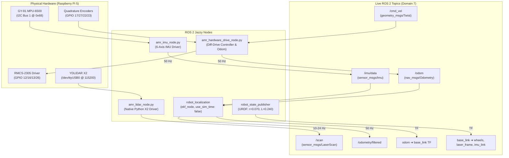

# AMR Physical Hardware Integration & Bringup Guide

This document is the master engineering reference for the physical hardware deployment of the Autonomous Mobile Robot (AMR) on the **Raspberry Pi 5** running **Ubuntu 24.04 LTS** and **ROS 2 Jazzy**.

---

## 1. Hardware Overview & Schematic

The robot is a differential-drive warehouse AGV powered by a 12.8V LiFePO4 battery pack, an RP1-based Raspberry Pi 5 single-board computer, an RMCS-2305 dual motor driver, 6-wire quadrature hall-effect encoders, a GY-91 6-axis IMU, and a YDLIDAR X2 360° LiDAR scanner.

```
+-------------------------------------------------------------------------+
|                        RASPBERRY PI 5 (UBUNTU 24.04 + ROS 2 JAZZY)      |
|                       40-Pin Header (RP1 Southbridge - 3.3V Logic)      |
+-------------------------------------------------------------------------+
       |                                      |
       |-- GPIO 12 (Pin 32) -> PWM1 (Left)    |-- GPIO 17 (Pin 11) -> L-Enc A
       |-- GPIO 16 (Pin 36) -> DIR1 (Left)    |-- GPIO 27 (Pin 13) -> L-Enc B
       |-- GPIO 13 (Pin 33) -> PWM2 (Right)   |-- GPIO 22 (Pin 15) -> R-Enc A
       |-- GPIO 26 (Pin 37) -> DIR2 (Right)   |-- GPIO 23 (Pin 16) -> R-Enc B
       |-- Pin 39 (GND)     -> RMCS Logic GND |-- Pin 1  (3.3V)   -> IMU VCC & Enc VCC
       |                                      |-- Pin 9  (GND)    -> L-Enc GND
       |-- I2C Bus 1:                         |-- Pin 14 (GND)    -> R-Enc GND
       |   * GPIO 2 (Pin 3) -> GY-91 SDA      |
       |   * GPIO 3 (Pin 5) -> GY-91 SCL      |-- USB 3.0 (/dev/ttyUSB0):
       |   * Pin 6 (GND)    -> GY-91 GND      |   * YDLIDAR X2 (115200 baud)
+-------------------------------------------------------------------------+
```

### Pre-Configuration (Pi 5 Power Delivery)
Because powering via the 40-pin GPIO header bypasses USB-C PD negotiation, the Pi 5 EEPROM and boot configuration are configured to unlock full 1.6A current output on USB ports (preventing the LiDAR motor from browning out):
- `sudo rpi-eeprom-config --edit` $\to$ `PSU_MAX_CURRENT=5000`
- `/boot/firmware/config.txt` $\to$ `usb_max_current_enable=1`

---

## 2. Calibrated Physical Constants & Kinematics

All low-level odometry, kinematics, and simulation models are calibrated to the physical chassis:

| Parameter | Measured Value | Metric Value | Impact on Differential Drive Kinematics |
| :--- | :--- | :--- | :--- |
| **Wheel Radius ($r$)** | $70\text{ mm}$ | **$0.070\text{ m}$** | Circumference $C = 2\pi r \approx \mathbf{0.43982\text{ m}}$ |
| **Track Width ($L$)** | $240\text{ mm}$ | **$0.240\text{ m}$** | Center-to-center distance between tires ($y = \pm 0.120\text{ m}$) |
| **Ticks / Revolution** | $4713\text{ ticks}$ | **$4713$** | High resolution: **$0.09332\text{ mm/tick}$** ($\approx 10,715\text{ ticks/m}$) |
| **Left Motor Polarity** | Inverted | — | `DIR1 = 0` (Forward), `DIR1 = 1` (Reverse) |
| **Right Motor Polarity**| Normal | — | `DIR2 = 1` (Forward), `DIR2 = 0` (Reverse) |
| **Left Encoder Polarity**| Inverted | — | Quadrature delta inverted so forward rotation counts $(+)$ |
| **Right Encoder Polarity**| Normal | — | Quadrature delta normal so forward rotation counts $(+)$ |
| **Driver Sleep Pins** | Unconnected | — | `SLP1` & `SLP2` left open (hardware default awake) |
| **IMU Configuration** | MPU-6500 | — | I2C address `0x68` (ID `0x70`), strictly 6-DOF (Accel + Gyro) |
| **LiDAR Interface** | YDLIDAR X2 | — | `/dev/ttyUSB0` at `115200` baud |

---

## 3. System Architecture & Data Flow



---

## 4. Software Implementation Details

### A. Differential Drive & Odometry Node
- **Source**: `src/agv_description/scripts/amr_hardware_drive_node.py`
- **Inverse Kinematics**:
  $$v_L = v_x - \frac{\omega_z \cdot L}{2}, \quad v_R = v_x + \frac{\omega_z \cdot L}{2}$$
- **Forward Odometry Integration (Runge-Kutta 2nd Order)**:
  $$\Delta d_L = \frac{\Delta\text{ticks}_L}{\text{ticks\_per\_rev}} \cdot (2\pi r), \quad \Delta d_R = \frac{\Delta\text{ticks}_R}{\text{ticks\_per\_rev}} \cdot (2\pi r)$$
  $$\Delta d = \frac{\Delta d_R + \Delta d_L}{2}, \quad \Delta\theta = \frac{\Delta d_R - \Delta d_L}{L}$$
  $$x_{k+1} = x_k + \Delta d \cos\left(\theta_k + \frac{\Delta\theta}{2}\right), \quad y_{k+1} = y_k + \Delta d \sin\left(\theta_k + \frac{\Delta\theta}{2}\right), \quad \theta_{k+1} = \theta_k + \Delta\theta$$
- **Safety Watchdog**: Stops motors automatically if `/cmd_vel` is silent for $> 1.5\text{s}$.

### B. 6-Axis IMU Node
- **Source**: `src/agv_description/scripts/amr_imu_node.py`
- **Chip Support**: MPU-6500 (WHO_AM_I = `0x70`) / MPU-9250 (WHO_AM_I = `0x71`).
- **Features**: Automatic zero-rate gyroscope bias calibration on startup (100 samples at rest), gravity vector tilt compensation, orientation quaternion integration, and covariance population.

### C. Native YDLIDAR X2 Driver Node
- **Source**: `src/agv_description/scripts/amr_lidar_node.py`
- **Features**: Pure-Python serial protocol reader (zero C++ SDK dependencies). Parses sync frames (`0xAA 0x55`), interpolates sample angles, projects points to a 360-bin array, and publishes standard `sensor_msgs/LaserScan` messages on `/scan` in the `laser_frame` TF frame.

### D. Real-Time Extended Kalman Filter (EKF)
- **Config**: `src/agv_description/config/ekf_hardware.yaml`
- **Configuration**: `use_sim_time: false`, fuses wheel odometry (`/odom`) linear velocity and IMU (`/imu/data`) angular velocity $\omega_z$, broadcasting the `odom -> base_link` transform at 50 Hz.

### E. Master Bringup Launch File
- **Source**: `src/agv_description/launch/hardware_bringup.launch.py`
- Launches all 5 nodes with a single command. Supports conditional arguments: `enable_lidar:=true/false`, `enable_ekf:=true/false`, `enable_imu:=true/false`, `enable_motors:=true/false`.

---

## 5. Startup & Operational Procedures

### Step 1: Build Workspace on the Raspberry Pi 5
Whenever nodes, launch files, or URDF files are modified:
```bash
source /opt/ros/jazzy/setup.bash
cd ~/AMR
colcon build --packages-select agv_description --symlink-install
```

### Step 2: Launch the Master Hardware Stack
In Terminal 1 on the Pi:
```bash
cd ~/AMR
./start_hardware.sh
```

### Step 3: Verify Topic Streaming
In Terminal 2 on the Pi, run the verification monitor:
```bash
cd ~/AMR
./verify_hardware_topics.sh
```
Or check frequencies manually:
```bash
source /opt/ros/jazzy/setup.bash
export ROS_DOMAIN_ID=7

ros2 topic hz /odom              # Expected: ~50 Hz
ros2 topic hz /imu/data          # Expected: ~50 Hz
ros2 topic hz /odometry/filtered # Expected: ~50 Hz
ros2 topic hz /scan              # Expected: ~10 to 24 Hz
```

### Step 4: Drive via Keyboard Teleoperation
In Terminal 3 on the Pi (or from a laptop on the same network with `ROS_DOMAIN_ID=7`):
```bash
source /opt/ros/jazzy/setup.bash
export ROS_DOMAIN_ID=7
ros2 run teleop_twist_keyboard teleop_twist_keyboard
```
| Key | Motion |
| :---: | :--- |
| **`i`** | Drive Forward |
| **`,`** | Drive Reverse |
| **`j`** | Pivot Turn Left |
| **`l`** | Pivot Turn Right |
| **`k`** | Immediate Stop |

### Step 5: Connect Remote RViz2 Visualization (Laptop)
From your laptop terminal:
```bash
cd ~/AMR/AMR-main
./connect_laptop_rviz.sh <PI_IP_ADDRESS>
```
*(To find your Pi's IP address, run `hostname -I` on the Pi or `ping amrita.local` from the laptop).*

---

## 6. Standalone Hardware Diagnostics & Calibration Tools

If testing individual hardware subsystems in isolation without launching ROS 2:

1. **WASD Motor Teleop Test**:
   ```bash
   python3 test_motor_teleop.py
   ```
   *(Hold-to-move interactive terminal HUD for forward, turns, reverse, speed adjustments, and live polarity toggling).*

2. **Encoder Ticks-Per-Revolution Measurement Tool**:
   ```bash
   python3 test_3_encoders.py
   ```
   *(Records 4x quadrature ticks and 1x pulses for a single 360° hand-rotation).*

3. **Full Hardware Diagnostics (12 Checks)**:
   ```bash
   python3 test_full_hardware.py --report
   ```
   *(Validates GPIO access, I2C scan, IMU accel/gyro/mag, LiDAR serial + scans, encoder pulse counting, motor spins, and synchronous 20 Hz acquisition).*

> [!CAUTION]
> **GPIO Resource Lock**: Only one program can control the motor GPIO pins at a time. When the ROS 2 hardware stack is running via `./start_hardware.sh`, always use `./teleop_hardware.sh` to drive the robot via `/cmd_vel` rather than `test_motor_teleop.py`.
>
> For an exhaustive, layer-by-layer analysis of every network, DDS, firewall, and ROS 2 issue encountered during hardware bringup and how each was resolved, see the **[Hardware Integration Troubleshooting Report](Hardware_Integration_Troubleshooting_Report.md)**.

