# 04. Hardware Setup, CycloneDDS Networking & Raspberry Pi Workflow

> **Navigation:** [Root README](../../README.md) · [01. Directory & Scripts](01-directory-and-scripts.md) · [02. Simulation Workflow](02-simulation-workflow.md) · [03. Simulation Errors & Fixes](03-simulation-errors-and-fixes.md) · **04. Hardware Setup & Pi** · [05. Hardware Mapping & Nav](05-hardware-mapping-and-navigation.md) · [06. Web Dashboard, Bridge & ML](06-web-dashboard-bridge-and-ml.md)

This guide covers the physical AMR hardware architecture, CycloneDDS Domain 7 cross-machine networking (WSL2 Laptop ↔ Raspberry Pi 5), `sync_to_pi.sh` synchronization, SSH + `NOPASSWD` clock sync, 1-click Web Dashboard vs CLI bringup, and step-by-step bench calibration.

---

## 1. Distributed Hardware Architecture

The physical deployment splits real-time I/O onto the onboard **Raspberry Pi 5** (`amr@10.244.248.208`, workspace `~/AMR`) while offloading SLAM, AMCL, MPPI navigation, RViz2, and the Web Dashboard onto the **Laptop** (`~/AMR/AMR-main`) over Wi-Fi using **CycloneDDS Domain 7**:

```mermaid
flowchart LR
    subgraph Pi ["Raspberry Pi 5 (10.244.248.208, ~/AMR)"]
        DRV["amr_hardware_drive_node.py\n(RMCS-2305 + 4713 CPR Encoders -> /odom @ 50Hz)"]
        IMU["amr_imu_node.py\n(GY-91 MPU-6500 I2C 0x68 -> /imu/data @ 50Hz)"]
        LID["amr_lidar_node.py\n(YDLIDAR X2 /dev/ttyUSB0 -> /scan @ ~10Hz)"]
        RSP["robot_state_publisher\n(warehouse_agv.urdf -> /tf_static)"]
        EKF["ekf_node (ekf_hardware.yaml)\n(/odom + /imu/data -> /odometry/filtered & odom->base_link)"]
    end

    subgraph DDS ["CycloneDDS Unicast (ROS_DOMAIN_ID=7, UDP 7400-9500)"]
        NET["config/cyclonedds.xml & /tmp/cyclonedds_pi.xml\nPeers: 127.0.0.1 + Remote IP"]
    end

    subgraph Laptop ["Laptop Workstation (WSL2 Ubuntu 24.04, ~/AMR/AMR-main)"]
        NAV["SLAM Toolbox / AMCL + auto_localizer\n+ route_runner + RViz2"]
        WEB["bridge_server.py (:8000)\n+ Web Dashboard (:5173)"]
    end

    Pi <--> DDS <--> Laptop
```



### Physical Wiring Pinout & Calibrated Constants
Verified from [`hardware_bringup.launch.py`](../../src/agv_description/launch/hardware_bringup.launch.py), [`amr_hardware_drive_node.py`](../../src/agv_description/scripts/amr_hardware_drive_node.py), [`amr_imu_node.py`](../../src/agv_description/scripts/amr_imu_node.py), and [`amr_lidar_node.py`](../../src/agv_description/scripts/amr_lidar_node.py):

| Component | Interface / BCM Pins (Physical Pin) | Key Launch Parameters |
| :--- | :--- | :--- |
| **Left Motor (RMCS-2305)** | `PWM1`: GPIO 12 (Pin 32), `DIR1`: GPIO 16 (Pin 36) (`0=Fwd, 1=Rev`) | `max_pwm_cap: 35.0%`, `ff_offset: 10.5`, `ff_slope: 55.0`, `breakaway_pwm: 17.5`, `pid_kp: 75.0`, `pid_ki: 150.0` |
| **Right Motor (RMCS-2305)** | `PWM2`: GPIO 13 (Pin 33), `DIR2`: GPIO 26 (Pin 37) (`1=Fwd, 0=Rev`) | `cmd_vel_timeout: 1.5 s`, `odom_rate: 50.0 Hz`, `publish_tf: False` (EKF owns TF) |
| **Left Quadrature Encoder** | Ch A: GPIO 17 (Pin 11), Ch B: GPIO 27 (Pin 13) *(inverted)* | `wheel_radius: 0.035 m` (`D=70 mm`), `wheel_separation: 0.240 m`, `ticks_per_rev: 4713` |
| **Right Quadrature Encoder** | Ch A: GPIO 22 (Pin 15), Ch B: GPIO 23 (Pin 16) *(normal)* | `invert_odom_linear: True`, `invert_odom_yaw: False`, `swap_encoders: False` |
| **IMU (GY-91 MPU-6500)** | I2C Bus 1 (`0x68`): SDA GPIO 2 (Pin 3), SCL GPIO 3 (Pin 5) | `rate: 50.0 Hz`, `calibrate_gyro: True`, `invert_gyro_z: True`, `gyro_deadband: 0.015` |
| **LiDAR (YDLIDAR X2)** | USB `/dev/ttyUSB0` @ `115200` baud | `frame_id: laser_frame`, `range_min: 0.15`, `range_max: 8.0`, `num_bins: 360`, `inverted: True`, `angle_offset: 180.0` |
| **Pi 5 Power Delivery** | GPIO 5V header via buck converter | EEPROM `PSU_MAX_CURRENT=5000` & `/boot/firmware/config.txt` `usb_max_current_enable=1` (prevents LiDAR brownouts) |

> [!NOTE]
> [`ekf_hardware.yaml`](../../src/agv_description/config/ekf_hardware.yaml) fuses `/odom` linear & angular velocity (`vx`, `vyaw`) with `/imu/data` angular velocity (`vyaw`) at `50.0 Hz` (`use_sim_time: false`) to publish `/odometry/filtered` and `odom -> base_link` TF.

---

## 2. CycloneDDS Domain 7 & WSL2 Networking Setup

Cross-machine ROS 2 communication over Wi-Fi faces four common traps in Windows 11 WSL2, all handled by [`config/cyclonedds.xml`](../../config/cyclonedds.xml) and [`scripts/hardware/env_hardware.sh`](../../scripts/hardware/env_hardware.sh) (see [`docs/Hardware_Integration_Troubleshooting_Report.md`](../Hardware_Integration_Troubleshooting_Report.md) for deep-dive logs):

### 2.1 WSL2 Mirrored Networking & Windows UDP Firewall (7400–9500)
1. Enable mirrored networking on Windows in `C:\Users\<user>\.wslconfig`:
   ```ini
   [wsl2]
   networkingMode=mirrored
   ```
2. Allow inbound RTPS/DDS UDP ports (`7400–9500`, where Domain 7 multicast/unicast data ports reside around `9150+`) in **PowerShell (Administrator)**:
   ```powershell
   New-NetFirewallRule -DisplayName "ROS2 WSL2 DDS" -Direction Inbound -Action Allow -Protocol UDP -LocalPort 7400-9500 -Profile Any
   ```

### 2.2 WSL2 `zeth` Adapter Binding & Loopback Peering (`config/cyclonedds.xml`)
In WSL2 mirrored mode, an internal adapter `zeth` (`192.0.2.2`) often appears alongside physical Wi-Fi `eth0`. Without explicit interface binding, CycloneDDS binds to `zeth` and drops Pi packets. Also, omitting `127.0.0.1` in `<Peers>` breaks intra-machine node discovery, and `<NetworkInterface autoselect="true"/>` is an invalid XML attribute that crashes `rmw_create_node`.

[`config/cyclonedds.xml`](../../config/cyclonedds.xml) (auto-regenerated by [`env_hardware.sh`](../../scripts/hardware/env_hardware.sh), [`start_hardware_mapping.sh`](../../scripts/hardware/start_hardware_mapping.sh), [`start_hardware_nav.sh`](../../scripts/hardware/start_hardware_nav.sh), and [`bridge_server.py`](../../app/bridge/bridge_server.py)) uses `ip route get <PI_IP>` to bind the exact Wi-Fi IP:

```xml
<?xml version="1.0" encoding="UTF-8" ?>
<CycloneDDS xmlns="https://cdds.io/config">
  <Domain Id="7">
    <General>
      <Interfaces>
        <NetworkInterface address="10.244.248.140"/>
      </Interfaces>
    </General>
    <Discovery>
      <Peers>
        <Peer Address="127.0.0.1"/>
        <Peer Address="10.244.248.208"/>
      </Peers>
    </Discovery>
  </Domain>
</CycloneDDS>
```

### 2.3 WSL2 `ros2 --no-daemon` Wrapper (`env_hardware.sh`)
In WSL2 mirrored mode, `ros2cli`'s XML-RPC daemon lookup on `127.0.0.1:11518` hangs for 60s (`TimeoutError: [Errno 110]`). Sourcing [`scripts/hardware/env_hardware.sh`](../../scripts/hardware/env_hardware.sh) configures `ROS_DOMAIN_ID=7`, `RMW_IMPLEMENTATION=rmw_cyclonedds_cpp`, `CYCLONEDDS_URI`, and defines a shell function wrapping `ros2 node list`, `ros2 topic list`, `ros2 topic hz`, and `ros2 topic echo` with `--no-daemon`:

```bash
source ~/AMR/AMR-main/scripts/hardware/env_hardware.sh 10.244.248.208
ros2 topic list   # responds immediately via --no-daemon
```

---

## 3. SSH Key Auth, NOPASSWD Clock Sync & `sync_to_pi.sh`

### 3.1 Passwordless SSH & Clock Sync Setup (One-Time)
`start_hardware_mapping.sh`, `start_hardware_nav.sh`, `sync_to_pi.sh`, and `PiRemoteManager` in `bridge_server.py` use non-interactive SSH (`BatchMode=yes`) to start/stop Pi bringup, copy maps, and sync the Pi system clock via `sudo -n date -s`.

1. **Copy SSH key from Laptop to Pi:**
   ```bash
   ssh-copy-id amr@10.244.248.208
   ```
2. **Allow passwordless `date` on Pi** (in `sudo visudo` on Pi):
   ```text
   amr ALL=(ALL) NOPASSWD: /usr/bin/date
   ```
   Verify from Laptop:
   ```bash
   ssh -o BatchMode=yes amr@10.244.248.208 "sudo -n date -s '@$(date +%s.%N)'"
   ```

### 3.2 Synchronizing Code, Scripts & Maps (`sync_to_pi.sh`)
[`scripts/hardware/sync_to_pi.sh`](../../scripts/hardware/sync_to_pi.sh) handles bidirectional `rsync` between Laptop (`~/AMR/AMR-main`) and Pi (`amr@<PI_IP>:~/AMR`), plus automatic ping & clock sync:

```bash
# Push src/, scripts/{hardware,diagnostics}/, config/cyclonedds.xml, and maps/ -> Pi:
./scripts/hardware/sync_to_pi.sh                  # defaults: push, 10.244.248.208
./scripts/hardware/sync_to_pi.sh push 10.244.248.208

# Pull maps saved on Pi and Pi logs (saved to logs/pi/) -> Laptop:
./scripts/hardware/sync_to_pi.sh pull [PI_IP]

# Bidirectional sync (push then pull):
./scripts/hardware/sync_to_pi.sh both [PI_IP]
```

After `push`, rebuild on Pi if `src/` changed:
```bash
ssh amr@10.244.248.208
cd ~/AMR && source /opt/ros/jazzy/setup.bash
colcon build --packages-select agv_description agv_navigation --symlink-install
```

---

## 4. Starting the Pi Hardware Stack: 1-Click Dashboard vs CLI

### Option A — 1-Click Web Dashboard Start/Stop (via Bridge SSH)
When the bridge runs in hardware mode (`./app/bridge/run_bridge.sh hardware 10.244.248.208`), `PiRemoteManager` in [`bridge_server.py`](../../app/bridge/bridge_server.py) automates Pi bringup over SSH:
- **Manual Pi Toggle or `auto_start_pi`:** Calling `POST /api/hardware/pi/start` (or starting Mapping/Navigation with `auto_start_pi: true`) detects the laptop IP, launches `setsid nohup ~/AMR/scripts/hardware/start_hardware.sh <LAPTOP_IP>` into `~/AMR/logs/pi_hardware_latest.log`, tracks `~/AMR/logs/pi_hardware.pid`, and waits for `/scan` and `/odometry/filtered` (keep the robot stationary during startup IMU gyro calibration!).
- **Stop:** `POST /api/hardware/pi/stop` (or `stop_pi_on_stop: true`) immediately commands `0.0` on `/cmd_vel` and terminates the Pi process group cleanly.
- **Inspect Remote Logs:** `GET /api/hardware/pi/logs?lines=60` (or the Pi log drawer in the Web UI).

### Option B — Manual CLI on Raspberry Pi (`start_hardware.sh`)
```bash
ssh amr@10.244.248.208
cd ~/AMR
./scripts/hardware/start_hardware.sh 10.244.248.140   # pass Laptop Wi-Fi IP for unicast DDS
```
Any extra launch arguments pass straight to `hardware_bringup.launch.py`, e.g.:
```bash
./scripts/hardware/start_hardware.sh 10.244.248.140 enable_lidar:=true enable_imu:=true enable_ekf:=true enable_motors:=true enable_slam:=false
```

---

## 5. Step-by-Step Bench Verification & Calibration

Run these diagnostics in order when verifying hardware on a bench (robot elevated on blocks before spinning motors):

1. **Test Two-Way UDP Link (Port 7410)** — confirms Windows Firewall & router permit UDP:
   ```bash
   # On Laptop:
   python3 ~/AMR/AMR-main/scripts/diagnostics/test_udp_link.py listen
   # On Pi:
   python3 ~/AMR/scripts/diagnostics/test_udp_link.py ping <LAPTOP_IP>
   ```
2. **Test Raw Motors & Polarity (ROS Stack Stopped!)**:
   > [!CAUTION]
   > `amr_hardware_drive_node.py` holds exclusive `lgpio` locks on RP1 GPIO pins. Stop `start_hardware.sh` before running raw GPIO bench scripts (`test_motor_teleop.py`, `test_3_encoders.py`, `test_full_hardware.py`), otherwise they fall back to mock mode.
   ```bash
   # On Pi (robot elevated on blocks):
   python3 ~/AMR/scripts/diagnostics/test_motor_teleop.py --speed 40 --watchdog 1.5
   ```
   Hold `W/A/S/D` or `1`/`2` (solo left/right), verify forward rotation, toggle polarity with `I`/`O` if reversed.
3. **Measure Encoder Ticks Per Revolution**:
   ```bash
   # On Pi:
   python3 ~/AMR/scripts/diagnostics/test_3_encoders.py
   ```
   Rotate each wheel forward exactly 1 full turn (`360°`); verify positive counting (`~4713` 4× quadrature ticks).
4. **Full 8-Subsystem Hardware Audit**:
   ```bash
   # On Pi:
   python3 ~/AMR/scripts/diagnostics/test_full_hardware.py --report
   # Or without spinning motors:
   python3 ~/AMR/scripts/diagnostics/test_full_hardware.py --skip-motors
   ```
5. **Verify Live ROS 2 Topics & Rates** (after starting `start_hardware.sh`):
   ```bash
   # On Pi (or Laptop after sourcing env_hardware.sh):
   ./scripts/hardware/verify_hardware_topics.sh
   ```
   Expected rates: `/odom` `~50 Hz`, `/imu/data` `~50 Hz`, `/odometry/filtered` `~50 Hz`, `/scan` `~10 Hz`.
6. **Verify Sensor Signs & LiDAR Quadrants Before SLAM**:
   ```bash
   # On Laptop (with env_hardware.sh sourced):
   python3 scripts/diagnostics/verify_sensors.py
   ```
   Stand in Front/Left/Right/Back of the LiDAR to confirm non-inverted quadrants, rotate robot by hand to confirm `/odom` and `/imu/data` yaw signs agree, and confirm EKF covariance stays `< 1.0`.
7. **Verify Live Hardware Stream in RViz2**:
   ```bash
   # On Laptop:
   ./scripts/hardware/connect_laptop_rviz.sh 10.244.248.208
   ```
   Opens RViz2 with [`agv_hardware.rviz`](../../src/agv_description/config/agv_hardware.rviz) (`Fixed Frame: odom`) and a fallback `map -> odom` static transform.
